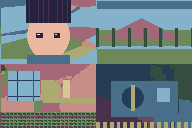
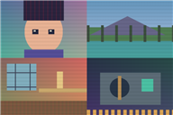
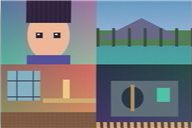

[English](README.md) · [简体中文](README.zh-CN.md) · [日本語](README.ja.md)

# FYLM Plugins

Pixel art, retro displays and analog video effects for **Adobe After Effects on Windows**.

Three independent effects live together in the **FYLM Plugins** category. Use them on their own or combine them in AE’s effect stack.

| Effect | What it does |
|---|---|
| **FYLM Pixel Art** | Dithering, print halftones, PC-98, GBA and modern pixel art. Adjust pixel size, limited palettes and detail cleanup; choose from 12 styles with 24 palette variations. |
| **FYLM CRT VHS** | CRT, VHS and combined modes. Tune scanlines, screen curvature, colour bleed, noise and animated tape interference, with eight VHS styles. |
| **FYLM ShaderGlass** | 38 built-in display, handheld, signal, scaling and colour looks. Browse by category, search and save favourites; adjust input resolution, strength, timing and preset parameters. |

| Pixel Art · PA02 A | ShaderGlass · SG02 | CRT VHS · VH05 |
|---|---|---|
|  |  |  |

Previews use original FYLM diagnostic artwork. They illustrate the effects, rather than screenshots of the AE interface.

## Get started

1. Close AE and aerender. Extract a Windows test package and run its `install.ps1` in administrator PowerShell.
2. Restart AE and add an effect from **Effects → FYLM Plugins**.
3. Pick a mode or preset, then adjust the controls. The interface follows AE’s language automatically.

Native Effect Controls update the preview directly. The optional **Window → FYLM Plugins** panel uses **Add / Connect → edit → Apply Panel Settings**. Loading a VHS style into this panel also requires applying it afterwards.

ShaderGlass can import supported `.slangp` sources and load/export compiled `.fylmsg` presets through native Effect Controls. Compatibility depends on the preset; temporal-history shaders are not supported. Scaling looks need a coarse input grid to be visible.

## Status

The source is a Windows development candidate. New 0.13 features and this UI revision still need testing in AE. macOS and complete `.slangp` compatibility are not included. See the [publication review](docs/PUBLICATION-REVIEW.md) and [build notes](docs/BUILDING.md).

## Referenced projects

- [Dithering Studio](https://github.com/Oslonline/dithering-studio)
- [godot-shader-crt-vhs](https://github.com/punikonta/godot-shader-crt-vhs)
- [ShaderGlass / ShaderGC](https://github.com/mausimus/ShaderGlass)
- [libretro/slang-shaders](https://github.com/libretro/slang-shaders)
- [ntsc-rs](https://github.com/valadaptive/ntsc-rs)
ntsc-rs is a reference for signal concepts; its Rust runtime is not included.

This repository contains components under different licences. See [NOTICE](NOTICE), [Apache-2.0](LICENSE), [GPL-3.0](LICENSE.GPL-3.0.txt) and the retained source headers. The top-level licence does not cover every component. Public-release attribution checks are tracked in the [publication review](docs/PUBLICATION-REVIEW.md).

