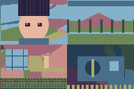
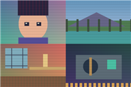
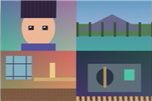

[English](README.md) · [简体中文](README.zh-CN.md) · [日本語](README.ja.md)

# FYLM Plugins

用于 **Windows 版 Adobe After Effects** 的像素画、复古显示器与模拟录像效果套件。

三个独立效果统一位于 **FYLM Plugins** 分组，可单独使用，也可在 AE 效果堆栈中组合。

| 插件 | 用途 |
|---|---|
| **FYLM Pixel Art** | 图像抖动、印刷网点、PC-98、GBA 和现代像素画。可调整像素大小、限制配色和整理细节，提供 12 套风格、24 组色板。 |
| **FYLM CRT VHS** | CRT、VHS 及组合模式。可调整扫描线、屏幕曲率、色彩渗漏、噪点与动态磁带干扰，提供八套 VHS 风格。 |
| **FYLM ShaderGlass** | 38 个内置显示器、掌机、模拟信号、像素缩放及调色效果。支持分类、搜索、收藏，以及输入分辨率、强度、时间和预设参数调节。 |

| Pixel Art · PA02 A | ShaderGlass · SG02 | CRT VHS · VH05 |
|---|---|---|
|  |  |  |

预览使用 FYLM 原创诊断图，展示滤镜效果，并非 AE 界面截图。

## 开始使用

1. 关闭 AE 和 aerender，解压 Windows 测试包，以管理员 PowerShell 运行包内 `install.ps1`。
2. 重启 AE，从“效果 → FYLM Plugins”添加插件。
3. 选择模式或预设，再调整参数。界面语言自动跟随 AE。

原生“效果控件”会直接更新预览。可选的“窗口 → FYLM Plugins”辅助面板采用“添加／连接效果 → 调整 → 应用面板设置”流程；在该面板载入 VHS 风格后，也需要点击应用。

ShaderGlass 可在原生效果控件中导入受支持的 `.slangp` 源预设，载入或导出 `.fylmsg` 编译预设。兼容性因预设而异，暂不支持依赖历史帧的着色器。像素缩放效果需要较粗的输入网格才能明显呈现。

## 当前状态

当前源码为 Windows 开发候选版本。0.13 新功能和本轮界面调整仍待 AE 实测，不包含 macOS 或全量 `.slangp` 兼容承诺。详见[发布检查](docs/PUBLICATION-REVIEW.md)和[构建说明](docs/BUILDING.md)。

## 引用项目

- [Dithering Studio](https://github.com/Oslonline/dithering-studio)
- [godot-shader-crt-vhs](https://github.com/punikonta/godot-shader-crt-vhs)
- [ShaderGlass / ShaderGC](https://github.com/mausimus/ShaderGlass)
- [libretro/slang-shaders](https://github.com/libretro/slang-shaders)
- [ntsc-rs](https://github.com/valadaptive/ntsc-rs)
- reimuplayer halftone — [provenance / 来源 / 出典](references/reimu-halftone)

ntsc-rs 用于模拟信号概念参考，未集成其 Rust 运行时。

本仓库包含多种许可证的组件。详见 [NOTICE](NOTICE)、[Apache-2.0](LICENSE)、[GPL-3.0](LICENSE.GPL-3.0.txt) 及保留的源文件署名。根目录许可证不覆盖所有组件；公开发布前的来源核查见[发布检查](docs/PUBLICATION-REVIEW.md)。

